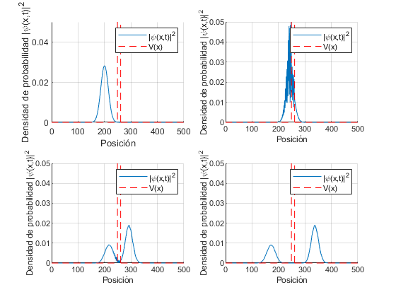
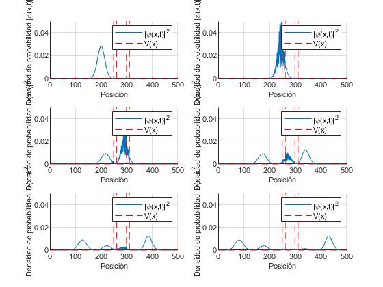
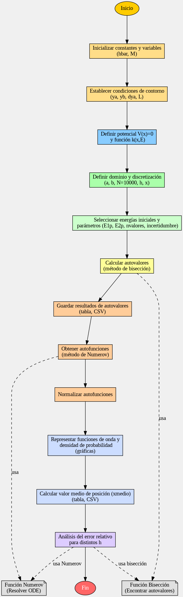
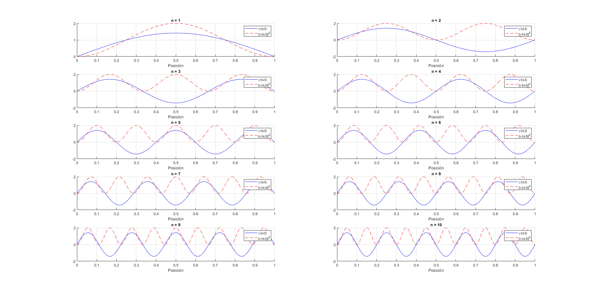
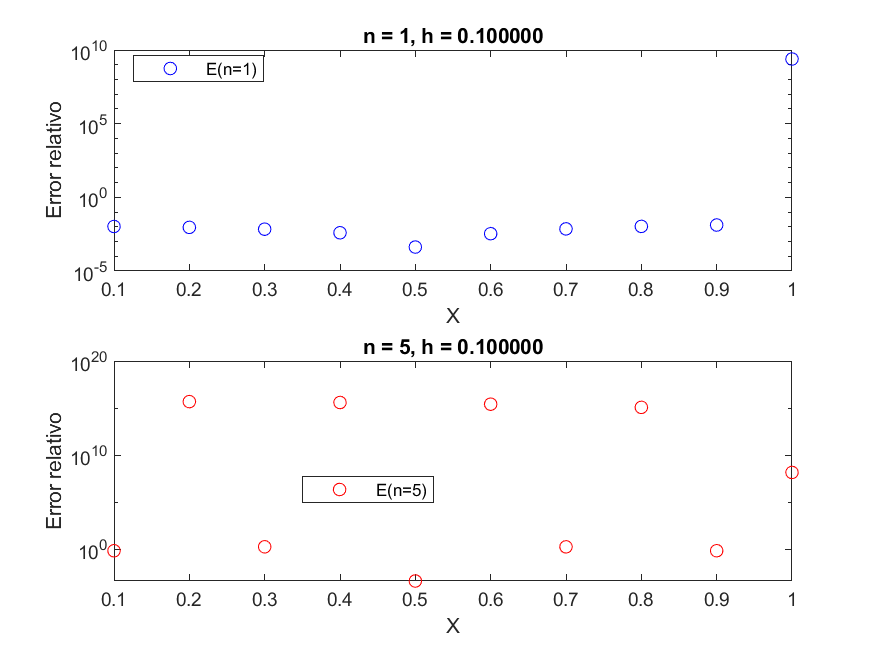
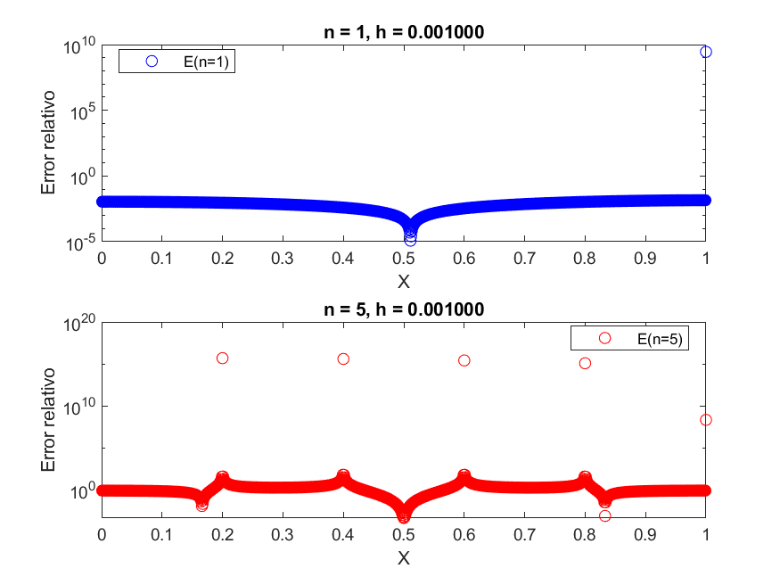
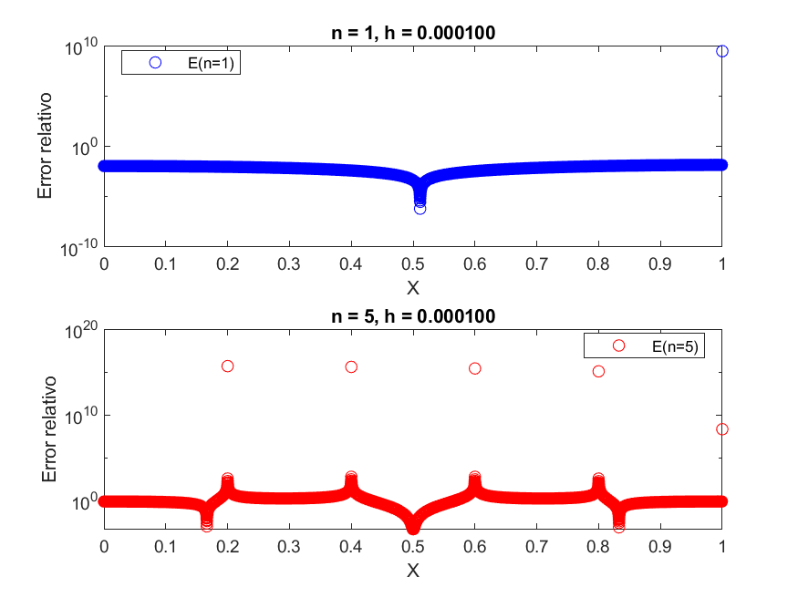

# 1D Schrödinger Equation in MATLAB

Two MATLAB scripts that numerically solve the Schrödinger equation in one
dimension:

- **Time-dependent:** evolution of a Gaussian wave packet hitting one or two
  potential barriers (quantum tunneling).
- **Time-independent:** computation of the eigenvalues and eigenfunctions of
  the problem `−ħ²/2M · ψ'' + V(x)·ψ = E·ψ` as an eigenvalue problem.

## 1. Time-dependent Schrödinger equation

`dependiente/schrodingerdependiente.m`

Solves

    iħ · ∂ψ/∂t = −ħ²/(2m) · ∂²ψ/∂x² + V(x)·ψ

with the implicit **Crank-Nicolson** method. At each time step the tridiagonal
system `A·ψⁿ⁺¹ = ωⁿ` is solved and the wave function is renormalized, so the
total probability stays equal to 1.

**Initial condition:** Gaussian packet with momentum `q` centered at `x₀`:

    ψ(x,0) = exp(i·q·x) · exp(−(x − x₀)² / (2σ²))

**Available cases** (variable `simn`):

| `simn` | Potential |
|---|---|
| 1 | One barrier of height `Vo` on `[c, d]` |
| 2 | Two barriers of height `Vo`, on `[c, d]` and `[e, f]` |

### Main parameters

| Variable | Default | Meaning |
|---|---|---|
| `a`, `b` | 0, 500 | Ends of the spatial domain |
| `dx` | 1 | Spatial step |
| `ti`, `tf` | 0, 2000 | Time interval |
| `dt` | 0.1 | Time step |
| `m`, `hbar` | 1, 1 | Natural units |
| `xo` | 200 | Initial position of the packet |
| `q` | 2 | Linear momentum of the packet |
| `sigma` | 20 | Width of the packet |
| `Vo` | 0.7 | Barrier height |
| `c`, `d` | 250, 260 | Position of the first barrier |
| `e`, `f` | 300, 310 | Position of the second barrier (only `simn = 2`) |
| `anim` | 1 | `1` shows the animation, `0` does not |

### Output

- Snapshots of the probability density `|ψ(x,t)|²` together with the potential
  `V(x)` at several times.
- Optional animation of the packet's evolution.
- Probability of finding the particle inside the barrier at each time step.

> **Note:** the script uses dense matrices and solves 20,000 time steps, so it
> can take a while. For a quick test, reduce `tf` or increase `dt`.

### Examples

<!-- Check that each caption matches its image -->

| One barrier | Two barriers |
|---|---|
|  |  |

Other figures: varying `q` (`q01.png`, `q20.png`, `q100.png`), wider barriers
(`unabarreragrande.png`, `dosbarrerasgrandes.png`) and `pozo01.png`,
`pozo1.png`, all in `dependiente/imagenes/`.

## 2. Time-independent Schrödinger equation

`independiente/schrodingerindependiente.m`

The eigenvalue problem is solved on the interval `[0, L]` with boundary
conditions `ψ(0) = ψ(L) = 0`, in normalized units and with a harmonic
potential `V(x) = ½·K·x²`. It is rewritten as

    ψ'' + k²(x, E)·ψ = 0

and solved with:

1. **Numerov's method** to integrate the wave function for a given value of `E`.
2. **Bisection (shooting) method** to find the energies `E` that satisfy the
   boundary condition at `x = L`.

For the first 10 eigenvalues the script:

- Compares the numerical energy with that of a particle in a box (`V = 0`),
  `Eₙ = n²π²/2`, and saves the table to `autovalores.csv`.
- Normalizes the eigenfunctions and plots `ψₙ(x)` and `|ψₙ(x)|²`.
- Computes the expected position `⟨x⟩` of each state and saves it to
  `xmedio.csv`.
- Studies the **relative error** of the `n = 1` and `n = 5` eigenfunctions for
  three step sizes `h = 0.1, 0.001, 0.0001`, and saves the plots as
  `simh<h>.png`.

### Main parameters

| Variable | Default | Meaning |
|---|---|---|
| `K` | 1 | Potential constant in `V(x) = ½·K·x²` |
| `L` | 1 | Interval length |
| `N` | 10000 | Number of grid points |
| `nvalores` | 10 | Number of eigenvalues to compute |
| `incertidumbre` | 1e-6 | Bisection tolerance |
| `hvalores` | `[0.1, 0.001, 0.0001]` | Step sizes for the error study |

### Results

| Method diagram | Eigenfunctions |
|---|---|
|  |  |

Relative error study as a function of the step size `h`:

| `h = 0.1` | `h = 0.001` | `h = 0.0001` |
|---|---|---|
|  |  |  |

## Repository structure

```
├── dependiente/
│   ├── schrodingerdependiente.m
│   └── imagenes/
└── independiente/
    ├── schrodingerindependiente.m
    ├── datos/          (autovalores.csv, xmedio.csv)
    └── imagenes/
```

## Usage

1. Open MATLAB and move to the folder of the script you want to run.
2. Run the script (`schrodingerdependiente` or `schrodingerindependiente`).
3. Edit the parameters at the top of the file to explore other cases.

The files generated by the scripts (`.csv`, `.png`) are saved in the current
working folder.

## Requirements

- MATLAB R2023b or later.
